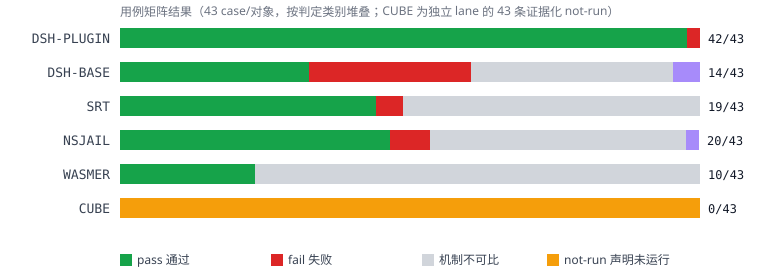
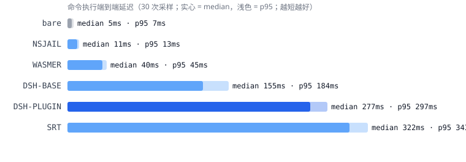

# hourglass

DSH（DeepSeek Harness）沙箱治理插件 + 可复现开源沙箱对比测试。
全部测试在 Docker privileged 容器内运行，判定只认真实副作用（文件快照差分 /
服务端 canary 记录 / 内核资源错误信号），从不以 stderr 文本断言作主判据。

- 本仓库：`D:\Aiproject\hourglass`（独立项目，DSH 仓库零修改，只读引用）
- 竞品分析（sandbox-runtime / wasmer / CubeSandbox 源码级对比 + 创新点）：
  [docs/competitive-analysis.md](docs/competitive-analysis.md)
- 设计决策：[ADR-001](docs/ADR-001-hourglass-plugin-scope.md)、
  [ADR-002](docs/ADR-002-res-quota-thresholds.md)

## 功能概览（六个包，DSH 仓库零修改）

| 包 | 能力 | 机制要点 |
|---|---|---|
| **@hourglass/sandbox-audit** | 追加式结构化审计账本 | begin（策略快照）+ end（终态分类）按 `callId` 关联；七类拒绝分类只认结构化信号；SHA-256 hash chain（篡改/删行可检出）；三层事实关联 os 层恒记 `unavailable`；参数脱敏；查询命令 `/sandbox-audit` |
| **@hourglass/sandbox-net** | 网络出口强制 | bwrap `--unshare-net` 内核级拒绝直连 + host 侧 allowlist 代理（bind-mounted unix socket + 沙箱内 TCP→unix 桥）为唯一出口；空 allowlist=deny-all；代理死亡/非 bwrap rung fail-closed |
| **@hourglass/sandbox-read** | 敏感读保护 | deny-read 路径 tmpfs 遮蔽（symlink/硬链接别名同遮蔽）；默认空集 opt-in；非 bwrap rung fail-closed |
| **@hourglass/sandbox-rsrc** | 资源配额 | prlimit 硬上限（RLIMIT_AS/CPU/FSIZE/NOFILE + NPROC）内核强制；nproc 配 `setpriv` uid 降权（规避 userns 内 CAP_SYS_ADMIN 豁免）；空配置零改变 |
| **@hourglass/sandbox-capabilities** | 能力清单 | 五能力 × 五后端矩阵；`enforced` 只能由 probe/test-result 证据支撑；查询命令 `/sandbox-capabilities` |
| **@hourglass/policy-ci** | 策略回归 | 合成 fixture + 纯函数语义模型 → 决策回放与 diff；CI 零网络/零模型；golden 字节稳定 |

## 安装

前置条件：Docker（本机验证版本 29.7.2，Docker Desktop on WSL2）。
容器内 GitHub 访问不可靠（见 `docker/Dockerfile` 注记），先在宿主侧下载 vendor
tarball 放入 `docker/vendor/`：

| 文件 | 来源 | 用途 |
|---|---|---|
| `nsjail-3.6.tar.gz` | github.com/google/nsjail tag 3.6 | nsjail 源码编译 |
| `kafel-master.tar.gz` | github.com/google/kafel master | nsjail seccomp 子模块预置 |
| `dsh-d743267.tar.gz` | codeload DSH commit d743267 | DeepSeek Harness 本体 |
| `codex-0.162.1.tar.gz` | OpenAI codex release | Codex CLI（无凭证 lane） |
| `wasmer-v7.3.0-linux-amd64.tar.gz` | wasmerio/wasmer release v7.3.0 | WASM 沙箱 lane（v7.4+ 需 GLIBC 2.38，超 bookworm） |
| `zig-0.13.0.tar.xz` | ziglang.org/download/0.13.0 | 镜像内编译 WASI 探针固件 |

```bash
# 构建测试镜像（三阶段：tools → dsh → test；固定所有竞品版本）
docker build -t hourglass-test -f docker/Dockerfile .

# 或经 compose（privileged + reports 卷挂载，等价）
docker compose -f docker/compose.yaml build
```

镜像内容：node:24-slim（bookworm）+ bubblewrap/nsjail/SRT/Codex/wasmer +
DSH（pinned commit，完整构建）+ hourglass 六包（fuse 进 DSH workspace）+
编译好的 WASI 探针固件（`/opt/hourglass-wasm/fs_probe.wasm`）。

> Git Bash 下若报 `docker-credential-desktop not found`：用项目级
> `DOCKER_CONFIG=.docker-config`（仓库已带）。

## 配置

**容器/运行级**（环境变量）：

| 变量 | 默认 | 作用 |
|---|---|---|
| `PERF_RUNS` | 30 | PERF 采样次数 |
| `ROB04_CYCLES` | 1000 | 生命周期循环次数 |
| `DSH_TELEMETRY_DISABLED` | 1（镜像内） | 关闭 DSH 遥测 |

**插件级**（cordis `ctx.plugin()` 挂载项，见
`scripts/sandbox-compare/driver/dsh-plugin-driver.ts`）：

| 插件 | 配置项 | 语义 |
|---|---|---|
| audit | `ledgerPath` | 账本 JSONL 路径 |
| net | `mode: allowlist \| deny-all \| unrestricted` + `allowlist: string[]` + `decisionLog` | 域名 allowlist（复用 policy-ci NET-09 规范化）；空表=deny-all |
| read | `denyRead: string[]` | tmpfs 遮蔽路径集（默认空=不启用） |
| rsrc | `{nproc, asBytes, cpuSeconds, fsizeBytes, nofile}` | prlimit 硬上限（阈值依据见 ADR-002） |

测试数据全部为合成 canary（`DSH_SYNTHETIC_CANARY_*`），不含任何真实凭据；
容器不挂载宿主目录（除 reports 输出）。

## 使用

```bash
# 一键全套：版本锁 gate → 单测（94 个，含 REAL-composition）→ smoke-p1 对比 → PERF → ROB-04 千次循环
docker run --rm --privileged -v "$(pwd)/reports:/opt/reports" \
  hourglass-test /usr/local/bin/hourglass-entrypoint run-all

# 分项命令
#   gates         版本锁校验（输出 sha256，报告必须引用）
#   unit          六包单测
#   compare       smoke-p1 对比矩阵（9 case × 4 subject 快速门）
#   compare-all   全量矩阵：43 case × 5 subject（DSH-BASE/DSH-PLUGIN/SRT/NSJAIL/WASMER）
#   compare-cube  CUBE lane（KVM 环境探测 → 43 条证据化 not-run 记录）
#   perf          PERF 基线（6 对象 × 30 次采样）
#   rob04         生命周期循环（fd/RSS/临时目录）
docker run --rm --privileged -v "$(pwd)/reports:/opt/reports" \
  hourglass-test /usr/local/bin/hourglass-entrypoint <command>

# 交互式进入
docker run --rm -it --privileged hourglass-test bash
```

DSH 会话内的查询命令：`/sandbox-audit`（账本查询）、
`/sandbox-capabilities`（能力清单，含证据引用）。

---

## 实验对比：测试环境 / 用例 / 数据 / 结论

对比对象与版本（`scripts/sandbox-compare/versions.lock.json`，本轮
sha256 `3baf3b24…77d244`；版本锁的任何变更需同 PR 评审）：

| 对象 | 版本 | 安装形态 | 角色 |
|---|---|---|---|
| DSH-BASE | d743267 | 源码（vendored tarball） | 插件前基线 |
| DSH-PLUGIN | d743267 + 本仓库六包 | workspace fuse | 本项目 |
| SRT | 0.0.79 | npm | 进程级沙箱（Anthropic） |
| NSJAIL | 3.6 | 源码编译 | Linux 强隔离参照 |
| WASMER | 7.3.0 | 官方二进制（vendored） | WASM 能力沙箱 |
| CUBE | 0.7.3+14（e0c1820） | 未安装（见下） | KVM microVM 沙箱池（腾讯） |
| CODEX | 0.162.1 | 官方二进制 | 无 OpenAI 凭证 → 整体 not-run |

### 测试环境

- 宿主：Windows + Docker Desktop on WSL2（Docker 29.7.2）；容器：
  `node:24-slim`（bookworm）privileged 一次性测试容器——bwrap/nsjail 的
  namespace 创建在非特权容器被 runtime 阻止（实测）。
- 受控本地网络服务：allow/deny 两个合成域名（`hourglass-{allow,deny}.tests.local`
  经容器 /etc/hosts 指向本机 eth0），服务端记录每个请求的 canary——网络类
  判定只看服务端证据。
- WASMER lane 使用镜像内编译的 WASI 探针固件（`fs_probe.wasm`，zig 0.13.0
  编译，源码 `scripts/sandbox-compare/fixtures-wasm/fs_probe.zig`）承载与 shell
  用例同语义的攻击操作（写/读/穿越/symlink/硬链接/父目录攻击）。
- CUBE lane：CubeSandbox 硬性要求 /dev/kvm + XFS(reflink) 数据卷 + systemd
  （其 `deploy/one-click/install.sh:913,1058` 安装器硬检查）；本容器实测
  `/dev/kvm` 不存在且 CPU 无 vmx/svm 标志 → 43 条 not-run 记录每条附探测证据。
  其性能数据以下引用官方裸金属基准并明确标注（未本地复现）。

### 用例说明（43 case，判定=外部世界证据）

| 类别 | 用例 | 攻击/验证语义 | 判定证据 |
|---|---|---|---|
| FS（12） | 01-06, 07, 08, 09, 10, 11, 12 | workspace 内正控写读；越界写/覆盖/删除；`..` 穿越；symlink/硬链接别名；父目录 rename/rm 攻击；解释器变体（python/node）；敏感文件读与 symlink 别名 | 文件快照差分 / 内容哈希不变 / 泄漏标记 |
| NET（12） | 01-07, 09-14 | allowlist 正控放行；非名单域名/剥代理/IP 直连/原生 TCP/IPv6/子进程/大小写规范化不误杀/空名单 deny-all/unix socket 直连/Harness 代调用/生命周期 | 服务端 canary 记录（零到达=拦截） |
| RES（8） | 01-08 | 墙钟准点杀；CPU 上限 SIGKILL（exit 137）；内存 RLIMIT_AS；进程数 NPROC（配 uid 降权）；文件大小恰截停 64KB；fd 上限；取消收敛（进程树全灭）；并发配额不串线 | 内核资源错误信号 + 副作用检查 |
| AUD（5） | 02, 09, 10, 11, 15 | 拒绝分类区分度；hash chain 完整性与篡改/删行检出；三层事实关联（begin+end+backend source）；结构化事实（非 stderr）；danger 模式审计披露 | 账本记录结构断言 |
| ROB（6） | 01-06 | runner 缺失 fail-closed；代理死亡 fail-closed；非法 allowlist 不放宽；千次循环零泄漏；崩溃孤儿清扫；重复挂载拒绝 | 错误面 + 副作用为零 + 循环指标 |

### 测试数据

**用例矩阵（v19，43 case × 5 subject = 215 结果，
`reports/runs/compare-all-20261017T064348Z/`）**



| 对象 | pass / fail | 机制不可比 | 不确定 | 说明 |
|---|---|---:|---:|---|
| **DSH-PLUGIN** | **42 / 1** | 0 | 0 | 唯一 fail = NET-13 有意暴露的 Harness 代调用边界（该调用已被完整审计） |
| DSH-BASE | 14 / 12 | 15 | 2 | 插件前基线的诚实缺口画像：网络 deny 放行×6、敏感读泄漏×2、资源无强制×3、NET-09 allow 正控失败（无域名规范化层，大写+尾点直连解析不成）；2 个 unknown 为 CPU/文件上限用例的收尾时序敏感（无上限证据） |
| SRT 0.0.79 | 19 / 2 | 22 | 0 | NET-01 = 环境限制（其 SSRF 防护拒本机地址）；RES-04 = CAP 豁免 |
| NSJAIL 3.6 | 20 / 3 | 19 | 1 | 机制差异如实呈现（netns 无 allowlist 通道等）；1 个 unknown 同上 |
| WASMER 7.3.0 | 10 / 0 | 33 | 0 | 全部适用 case（FS 9 + fail-closed 1）真实通过；33 个不可比均有具体理由（preview1 无 socket/无子进程/CLI 无资源上限/映射卷下无 deny-read） |
| CUBE 0.7.3+14 | 0 / 0 | — | — | 43 条 not-run（独立 lane，`compare-cube-20261017T064756Z`），每条附 KVM/XFS/systemd 探测证据 |

**性能（PERF-01，30 次采样/对象，`reports/runs/perf-20261017T064810Z/`）**



| 对象 | median | p95 | 相对 bare |
|---|---:|---:|---:|
| bare（无沙箱） | 5ms | 7ms | — |
| NSJAIL | 11ms | 13ms | ×2.2 |
| WASMER | 40ms | 45ms | ×8.0 |
| DSH-BASE | 155ms | 184ms | ×31.0 |
| DSH-PLUGIN | 277ms | 297ms | ×55.4 |
| SRT | 322ms | 343ms | ×64.4 |
| CUBE（官方，未本地复现） | 创建 47.8ms | p95 57.4ms | 裸金属基准，20 并发吞吐 180.9/s |

钩子级 micro-bench：审计 append 0.0113ms/记录（begin+end 对 ≈ 0.023ms/调用）。
DSH-PLUGIN 相对 DSH-BASE 的 +122ms 端到端差值主要来自 compare 管线的 driver
进程启动与完整工具流水（node 冷启 + 组件挂载），不是治理钩子本身。

### 结论

1. **DSH-PLUGIN 是唯一具备完整治理面的对象**：42/43 通过且零机制不可比——
   文件边界、网络出口（服务端零记录）、敏感读（零泄漏）、资源配额（内核级
   拒绝）、审计链（篡改可检出）、fail-closed（六类）全部由真实副作用判定。
2. **进程级沙箱 vs 能力沙箱的取舍清晰可见**：WASMER 在其可表达的用例上
   全过且启动开销只有 DSH-PLUGIN 的 1/7（40ms vs 277ms），但 33/43 用例
   不可比——能力模型的治理面（资源上限、审计、任意命令负载）需要嵌入层
   补齐；对"LLM agent 跑任意 shell"场景不可替代。
3. **强隔离与重部署互为代价**：CubeSandbox 的硬件级隔离与亚百毫秒快照启动
   以 KVM/XFS/systemd 硬门槛为前提（本环境不可复现，如实引用官方数据）；
   NSJAIL 最快（11ms）但无策略语义（allowlist/denyRead 均不可表达）。
4. **SRT 是策略深度最接近的竞品**：deny 语义全部真实通过；其 allow 通道与
   资源配额分别受环境限制（SSRF 防护拒本机地址）与配置面缺失约束。
5. DSH-BASE 的 12 个 fail 全部是插件前真实缺口（网络 deny 放行×6、敏感读
   泄漏×2、资源无强制×3、allow 正控无规范化×1），在 DSH-PLUGIN lane 全部转为
   通过；另有 15 个机制不可比（审计/并发会话/生命周期类仅插件语义可表达）与
   2 个 unknown 同样归零。

能力清单（v9 实测，test-result 证据）：DSH-PLUGIN 五项全部 enforced
（fileRead / fileWrite / netEgress / resourceLimits / processControl）；
DSH-BASE fileWrite=enforced 之外四项 absent。

## 竞品分析与创新点

完整源码级分析（架构/隔离/性能/语言平台/安全/易用/生态七维度 × 三竞品，
file:line 证据）与差距归纳（G1-G7）见
[docs/competitive-analysis.md](docs/competitive-analysis.md)。三个创新方向：

1. **cgroup v2 per-call 配额墙**（P1）——进程数/CPU/内存内核级硬限制不再依赖
   rlimit+uid 降权组合；cgroup pids 不受 CAP_SYS_ADMIN 豁免影响，是 RES-04
   的唯一无降权解法；配额命中事件可让账本 os_observation 层首次获得真实
   内核事件。
2. **模型可读的拒绝归因闭环**（P1）——把审计分类与 policy-ci reason 在
   result hook 注入结构化归因（被拒域名/路径、策略条目、建议动作），
   形成"账本→模型反馈"组合（SRT 验证过产品价值，hourglass 独有账本侧）。
3. **会话快照与回滚**（P2）——借鉴 Cube 的快照经济学，在文件层以
   overlayfs/reflink 实现 workspace 快照 + 秒级回滚，账本锚定 rollback
   事件（"可审计的时光机"，竞品均无此组合）。

## 已知边界（如实声明）

- **Harness 代调用旁路（NET-13）**：受限会话经 harness 自身的 web fetch 可到达
  deny 目标（服务端证据证实）——DSH 架构的已知边界；hourglass 保证该调用有
  完整审计记录（非未审计旁路），当前不阻断。
- **进程数硬限制的代价（RES-04）**：RLIMIT_NPROC 在 userns 内被 CAP_SYS_ADMIN
  豁免；hourglass 用 setpriv uid 降权使其生效——nproc 强制伴随 uid 降权。
  纯 cgroup pids 方案（无降权代价）即创新点 1。
- **网络强制的覆盖面**：HTTP/HTTPS 走代理通道；原始 TCP/非 HTTP 协议无代理
  路径，被 OS 层整体阻断（阻断事实 ≠ 代理判定）。域名解析在 host 侧。
- **WASMER lane 的不可比声明**：WASI preview1 无 socket/子进程；CLI 无资源
  上限（燃料计量与内存 Tunables 为嵌入层 API）；映射卷之下无 deny-read——
  33 个机制不可比均在 versions.lock 与报告逐条声明，绝不静默跳过。
- **CUBE/CODEX lane**：分别因 KVM 环境不可满足与无 OpenAI 凭证而整体 not-run，
  每条记录附原因；Cube 性能数据为官方基准（明确标注未本地复现）。
- **审计防篡改（AUD-09）为检测性能力而非抵抗性**：hash chain 检出任何篡改/
  删行/重排，但不阻止有文件写权限的攻击者破坏账本本身。
- **v19 的 3 个 unknown**（DSH-BASE RES-02/05、NSJAIL RES-02）：上限类判定在
  进程收尾时序上的输出敏感（SIGTERM vs "Killed" 字符串）——底数事实不变
  （无 CPU/FSIZE 上限证据），两轮结果（v18 无 unknown / v19 有）如实并存。

## 仓库布局

```
packages/audit/            @hourglass/sandbox-audit
packages/capabilities/     @hourglass/sandbox-capabilities
packages/policy-ci/        @hourglass/policy-ci（+ golden fixtures）
packages/net/              @hourglass/sandbox-net
packages/read/             @hourglass/sandbox-read
packages/rsrc/             @hourglass/sandbox-rsrc
scripts/sandbox-compare/   对比测试（43 case、versions.lock、WASI 固件源码）
docker/                    三阶段 Dockerfile + compose + entrypoint + vendor/
docs/                      ADR-001/002、competitive-analysis、assets/（图表）
reports/                   final-report.md + runs/（原始 JSON 数据）
```

## 开发

- 单测：容器内 `hourglass-entrypoint unit`（94/94 绿）；纯函数注入点
  （classify/decide/confine 重写函数等）无需真实沙箱即可全覆盖。
- 竞品分析再生产：三仓库本地 clone（sandbox-runtime/wasmer/CubeSandbox）
  的调研方法与证据索引见 docs/competitive-analysis.md §8。
